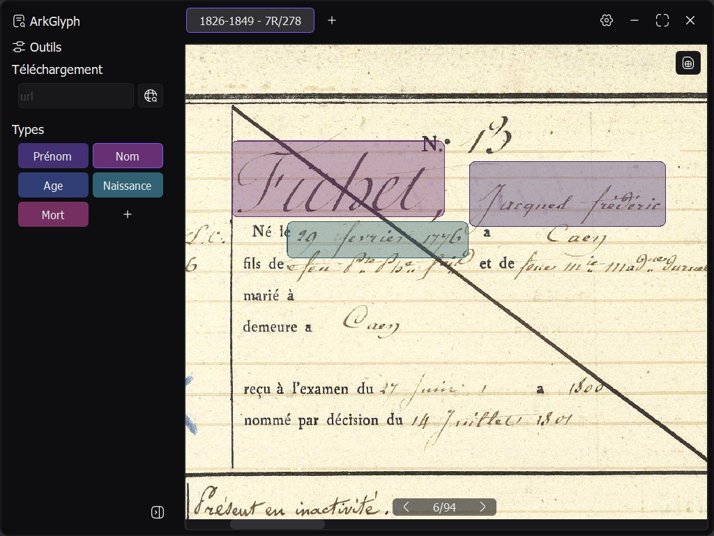

# ArkGlyph

[](https://www.gnu.org/licenses/gpl-3.0)
[](https://doc.qt.io/)

A PySide6 app designed to help archivists convert scanned images into text in a usable format

## Installation

1.  Clone the repository :

    `git clone https://github.com/Arkstone27/ArkGlyph.git`

2.  Execute the python file :

    `main.py`

## Structure
```
ArkGlyph/
│
├── interface/   # All the logic of the front-end
├── gestion_lot/ # Functions/Class for downloading and storing a collection of archives
├── traitement/  # All functions and logic for reading text
│
└── main.py 
```

## Information
This project is currently intended for French-speaking users.
Ongoing work to standardize the pages of an archive collection. Meaning: Correction of rotation, scale, and translation.




## Documentation

_Coming..._
